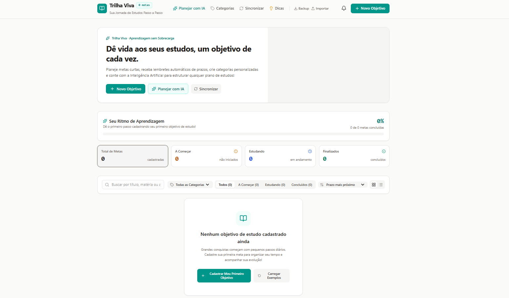

# 🌱 Trilha Viva — Objetivos de Estudo

Aplicação web desenvolvida para ajudar estudantes a organizar seus objetivos de estudo, acompanhar seu progresso e planejar uma rotina de aprendizado. O projeto combina ferramentas de organização com recursos de inteligência artificial para tornar o planejamento mais prático e personalizado.

## 🚀 Demonstração online

**[Acesse a Trilha Viva](https://trilha-gestor-de-objetivos.onrender.com/)**

Experimente a aplicação diretamente pelo navegador.

## ✨ Funcionalidades

- **Gerenciamento de objetivos:** crie, edite, exclua e acompanhe suas metas de estudo.
- **Acompanhamento de progresso:** visualize a evolução dos objetivos e o andamento das atividades.
- **Painel de controle:** consulte informações importantes sobre sua rotina de estudos.
- **Busca e filtros:** encontre objetivos com mais facilidade.
- **Prazos e lembretes:** organize seus estudos considerando as datas definidas.
- **Categorias personalizadas:** agrupe objetivos de acordo com suas necessidades.
- **Planejamento com IA:** gere sugestões de planos de estudo e refine seus objetivos com auxílio de inteligência artificial.
- **Sincronização:** transfira seus dados entre dispositivos utilizando códigos de sincronização.
- **Backup de dados:** exporte suas informações em formato JSON.

## 🛠️ Tecnologias utilizadas

- **React** — construção da interface.
- **TypeScript** — tipagem e organização do código.
- **Vite** — ambiente de desenvolvimento e build.
- **Tailwind CSS** — estilização da interface.
- **Node.js e Express** — estrutura do servidor.
- **Google Gemini API** — integração com inteligência artificial.

## 💡 Sobre o desenvolvimento

A Trilha Viva é um projeto autoral desenvolvido para colocar em prática conhecimentos de desenvolvimento web, integração com APIs e criação de soluções voltadas a problemas reais.

Durante o desenvolvimento, foram explorados conceitos como gerenciamento de estado, organização de componentes, persistência e sincronização de dados, além da integração de recursos de inteligência artificial com auxílio do Google AI Studio.

## 🔮 Melhorias futuras

- Aprimorar a experiência em dispositivos móveis.
- Expandir os recursos de planejamento de estudos.
- Adicionar novas formas de acompanhar o progresso.

---

**Projeto pessoal desenvolvido com foco em aprendizado, organização e produtividade nos estudos.**

🌱 **Trilha Viva — pequenos passos, grandes conquistas.**
